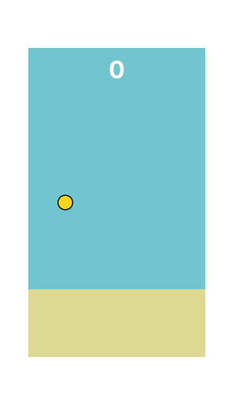
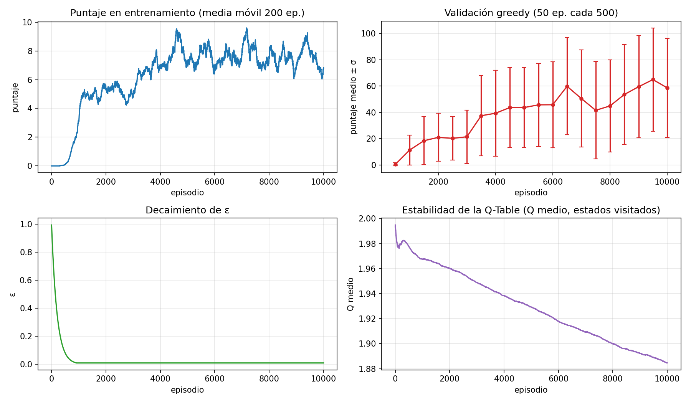
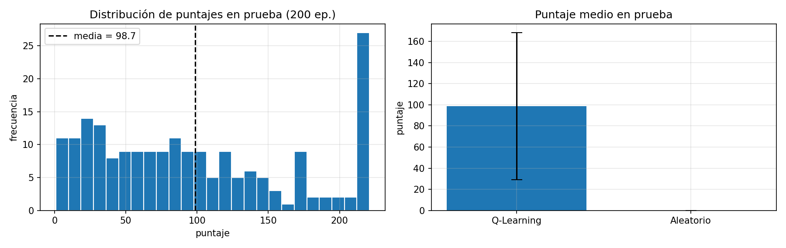

<div align="center">

# 🐦 Agente para Flappy Bird con Q-Learning

**Proyecto de Inteligencia Artificial · Universidad Privada Antenor Orrego (UPAO)**
Facultad de Ingeniería · Escuela Profesional de Ingeniería de Sistemas · Trujillo, Perú · 2026

[](https://saidnico3102-ops.github.io/flappy-bird-qlearning/)
[](https://colab.research.google.com/github/saidnico3102-ops/flappy-bird-qlearning/blob/main/notebooks/Flappy_Bird_QLearning_Colab.ipynb)




</div>

## ¿De qué trata?

Un agente autónomo que **aprende a jugar Flappy Bird por prueba y error** con **Q-Learning tabular**. El espacio de estados continuo se discretiza en `(dx, dy, vel)` → 15 × 20 × 12 = **3 600 estados × 2 acciones = 7 200 valores Q**. Se entrena en ~1 minuto en CPU, sin GPU y sin Pygame, y su conocimiento se puede inspeccionar directamente en la Q-Table.

## Resultados (Q-Table congelada, política greedy ε = 0)

| Agente | Media | Mediana | Máx. | Supervivencia |
| --- | --- | --- | --- | --- |
| **Q-Learning (mejor checkpoint)** | **98.7** | 84 | 221 | **11.5 %** |
| Agente aleatorio (línea base) | 0.0 | 0 | 0 | 0 % |

Validación cruzada con 5 bloques de semillas no vistas: **93.4 ± 8.0 (CV = 8.6 %)**. Todas las métricas se reproducen ejecutando `python scripts/evaluar.py`.

| Curvas de aprendizaje | Evaluación en prueba |
| --- | --- |
|  |  |

## Estructura del repositorio

```
flappy-bird-qlearning/
├── index.html                  # Demo web (GitHub Pages): juega, entrena y carga la Q-Table
├── src/flappy_qlearning/       # Código del sistema
│   ├── config.py               #   hiperparámetros y semillas (CONFIG)
│   ├── env.py                  #   FlappyBirdEnv (simulador sin interfaz)
│   ├── discretizer.py          #   StateDiscretizer (normalización + binning)
│   ├── agent.py                #   QLearningAgent (ε-greedy, Bellman, save/load)
│   └── train.py                #   bucle de episodio, evaluación y entrenamiento
├── scripts/                    # entrenar.py · evaluar.py · generar_gif.py
├── tests/                      # pruebas automáticas (pytest)
├── models/qtable_flappy.npy    # Q-Table entrenada (15, 20, 12, 2)
├── notebooks/                  # Cuaderno de Google Colab del informe
└── docs/                       # Informe, figuras y GIF
```

## Cómo ejecutarlo

### Opción A · Demo web (sin instalar nada)
Abre la [demo](https://saidnico3102-ops.github.io/flappy-bird-qlearning/), pulsa **📂 Cargar Q-Table**, elige `models/qtable_flappy.npy` y luego **Evaluar**: debe dar **98.7** de media, igual que el informe.

### Opción B · Local (VS Code / terminal)
```bash
git clone https://github.com/saidnico3102-ops/flappy-bird-qlearning.git
cd flappy-bird-qlearning
python -m venv .venv && source .venv/bin/activate      # Windows: .venv\Scripts\activate
pip install -r requirements.txt

python scripts/evaluar.py      # reproduce las métricas del informe con la Q-Table incluida
python scripts/entrenar.py     # (opcional) reentrena 10 000 episodios, semilla 42
python scripts/generar_gif.py  # (opcional) regenera docs/flappy_agente.gif
python -m pytest tests -q      # 12 pruebas
```

### Opción C · Google Colab
Pulsa el botón **Abrir en Colab** de arriba y ejecuta *Entorno de ejecución → Ejecutar todo*.

## Configuración base

α = 0.10 · γ = 0.95 · ε: 1.0 → 0.01 (decay 0.995) · Q₀ = 2.0 (optimista) · bins (15, 20, 12) · rango dy ±128 px · semilla 42 · 10 000 episodios. Recompensas: +0.1 por paso con vida, +1.0 por tubo cruzado, −1.0 por colisión.

## Limitaciones declaradas

Inestabilidad de la política entre episodios por *aliasing* de la discretización, supervivencia absoluta baja (11.5 %), una sola semilla de entrenamiento y validación saturada en 110 puntos por el límite de 5 000 pasos. Mejoras propuestas: α = 0.05, discretización no uniforme de dy, más semillas y una comparación con DQN.

## Equipo

Banda Orbegoso, Andre Alejandro · Esquerre Martos, Charles Rances · Rodríguez Becerra, Diego Arturo · Rios Alcántara, Diego José · Clavijo Diaz, Cesar Joaquin · Yengle Alfaro, Sebastian Beltran · Miñan Sandoval, Said Sebastian

**Docente:** Dr. Teobaldo Hernán Sagástegui Chigne · **Asignatura:** IA Principios y Técnicas · **NRC:** 5028

## Referencias principales

Watkins & Dayan (1992), *Q-learning* · Mnih et al. (2015), *Human-level control through deep reinforcement learning* · Sutton & Barto (2018), *Reinforcement Learning: An Introduction* · Vu & Tran (2020), *FlapAI Bird* · Li (2024), *Q-Learning and DQN in Flappy Bird*.

Licencia: [MIT](LICENSE).
